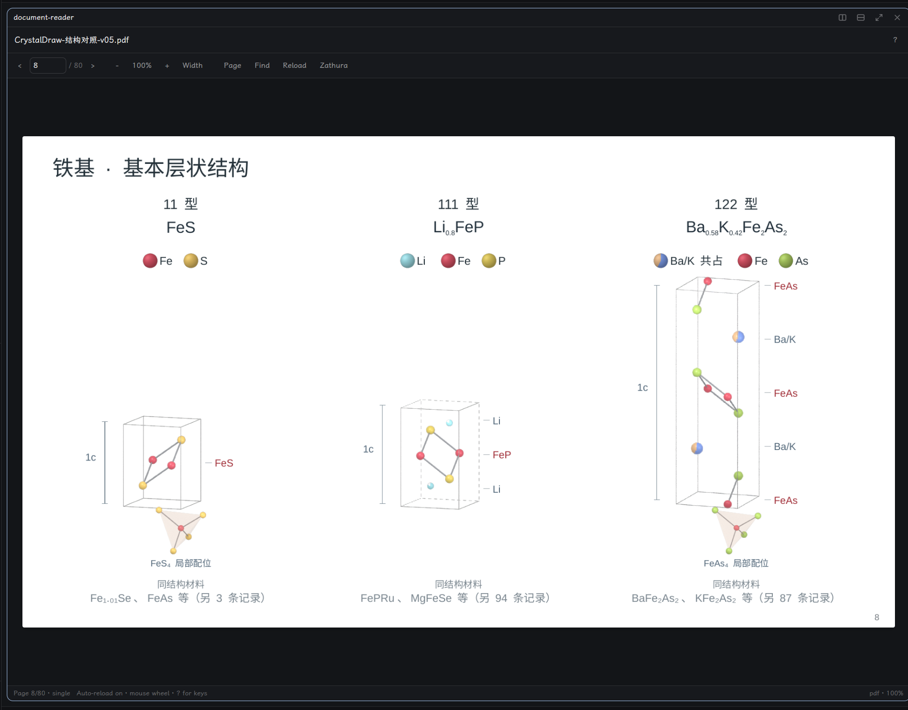

# Herdr Document Reader

A native, read-only PDF and Office document reader for [Herdr App](https://herdr.dev). It uses Herdr's mod APIs and GPUI elements—no WebView, browser panel, host patch, or embedded external window.



## Features

- PDF, Word, Excel, PowerPoint, and OpenDocument files.
- Single-page and continuous scrolling modes.
- Mouse toolbar, wheel navigation, Ctrl+wheel zoom, drag panning, and double-click zoom.
- Zathura-inspired Vim keys that leave Herdr's own Ctrl/Cmd/Alt shortcuts alone.
- Page-number input, text search with match counts and page jumping.
- Automatic reload when the source file changes, preserving the current view when possible.
- Optional external opening in Zathura for PDFs or LibreOffice for Office documents.
- Native Herdr themes, panes, tabs, overlays, commands, and focus handling.

## Requirements

- Linux with Herdr App 0.1.15 (the tested version).
- Poppler utilities: `pdfinfo`, `pdftoppm`, and `pdftotext`.
- LibreOffice for Office conversion (`soffice`); PDF viewing does not need LibreOffice.
- Zathura is optional and used only by the external-open action.

On Debian/Ubuntu, the Poppler package is `poppler-utils`. On Arch Linux it is `poppler`.

## Install

Copy the mod into Herdr's home:

```sh
cp -R mods/document-reader ~/.config/herdr-app/mods/
herdr-app check ~/.config/herdr-app/mods/document-reader
```

The manifest is `"place": "none"`: installing does not add a permanent sidebar or change your layout.

Open a document as a new tab:

```sh
herdr-app do tab.new \
  --name 'Document' \
  --mod document-reader \
  --props '{"file":"/absolute/path/to/document.pdf"}'
```

Or open it beside the current pane:

```sh
herdr-app do pane.split \
  --direction right \
  --mod document-reader \
  --props '{"file":"/absolute/path/to/presentation.pptx"}'
```

Supported extensions:

- PDF: `.pdf`
- Word: `.doc`, `.docx`, `.odt`, `.rtf`
- Excel: `.xls`, `.xlsx`, `.ods`
- PowerPoint: `.ppt`, `.pptx`, `.odp`

## Herdr key integration

The reader's unmodified and navigation keys work when its pane has focus. To add the two Herdr-level commands, merge this section into `keys.json` (do not replace your existing sections):

```json
"mod:document-reader": {
  "ctrl-shift-f": "document-reader.search",
  "ctrl-shift-r": "document-reader.reload"
}
```

Other Herdr shortcuts continue to work, including the command palette, pane navigation, tab management, and application zoom.

### Reader keys

| Key | Action |
|---|---|
| `j` / `k`, arrows, `J` / `K` | Next / previous page |
| `Ctrl-d` / `Ctrl-u` | Half-screen down / up |
| `Ctrl-f` / `Ctrl-b` | Page down / up |
| `gg`, `G`, `12G` | First page, last page, page 12 |
| `h` / `l` | Pan a zoomed page |
| `+` / `-` | Zoom in / out |
| `0` / `a`, `s` | Fit page, fit width |
| `c` | Toggle single-page / continuous mode |
| `/`, `n`, `N` | Search, next match, previous match |
| `r` / `R` | Reload the latest source file |
| `o` | Open externally |
| `q` | Close the reader pane |
| `?` | Open the key and mouse help |

### Mouse

- Wheel: turn pages in single-page mode; scroll in continuous mode.
- Ctrl+wheel: zoom around the pointer in single-page mode.
- Drag: pan an enlarged page.
- Double-click: toggle fit-page and 200% zoom at the pointer.
- Every toolbar action also works without the keyboard.

## Open from a file tree

A file panel can open the reader with:

```js
run("tab.new", {
  name: basename(path),
  space,
  mod: "document-reader",
  props: { file: path },
});
```

Herdr's shipped Files panel and layouts are read-only: clone them before changing their click handling. A `herdr-nvim` file tree can route `.pdf` and the Office extensions above to the same command.

## Mod commands

Shown reader copies accept commands through Herdr's `<mod>.<command>` mechanism:

```text
document-reader.next
document-reader.prev
document-reader.zoom-in
document-reader.zoom-out
document-reader.fit
document-reader.fit-width
document-reader.continuous
document-reader.reload
document-reader.search
document-reader.search:Fe
document-reader.search-next
document-reader.search-prev
document-reader.help
document-reader.open
```

`document-reader.search:Fe` searches for `Fe`; URI-escaped queries are decoded too.

## Files and programs

The mod makes no network requests. It reads the selected local document and writes only under `~/.config/herdr-app/data/document-reader/`.

- PDF rendering: `pdfinfo`, `pdftoppm`, `pdftotext`.
- Office conversion: LibreOffice through `soffice`, with an isolated profile and `TMPDIR` inside the cache.
- Cache and metadata: `stat`, `mv`, and `rm` through Herdr's `exec` API.
- External opening: `zathura` or `libreoffice`.

Cached pages are keyed by source path, modification time, size, page, and render quality. Conversion and page writes use temporary files followed by atomic renames. Inactive cache entries are pruned after 14 days or above 60 document versions.

## Current limits

- Local files only; remote documents need a local copy.
- Password-protected PDFs are not supported yet.
- Office documents are static PDF previews, not editable documents or native spreadsheets.
- Excel pagination follows the workbook's print settings.
- Search jumps to matching pages but does not highlight text in the raster.
- PDF links, forms, annotations, animations, and SyncTeX are not implemented.
- Physical mouse/keyboard input was not automated under Wayland; real-window rendering and Herdr mod commands were exercised instead.

See [RECIPE.md](RECIPE.md) for the implementation brief, compatibility notes, and verification checklist.
