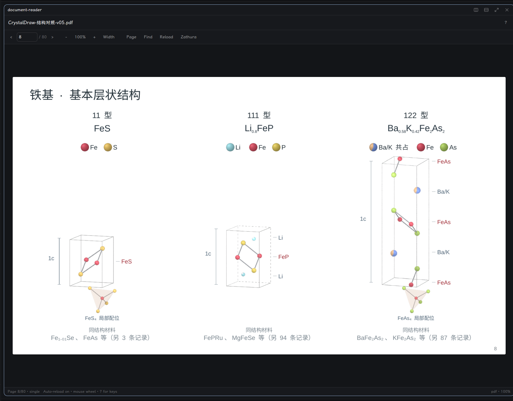

# Document Reader

A read-only document pane for Herdr App: PDF directly, and Word, Excel, PowerPoint, or OpenDocument through LibreOffice conversion. It has single-page and continuous views, mouse controls, Zathura-inspired keys, search, and Zathura-like automatic reload. It never embeds a Zathura or LibreOffice window and never docks a permanent sidebar.



## What you see

All colors come from `theme()`; the UI follows Herdr's appearance and zoom.

- **Header, 42px:** the source filename, an optional `Auto-refreshing…` indicator, and a `?` help button. A 1px `border` separates it from the toolbar.
- **Toolbar, 40px:** previous page, a 58px page-number input, total pages, next page, `−`, zoom percentage, `+`, `Width`, `Page`/`Scroll`, `Find`, `Reload`, and `Zathura` or `LibreOffice`. The strip scrolls horizontally when narrow.
- **Body:** `canvas` behind the document. A loaded page is a native `image()` with 3px corners and a medium shadow.
  - **Single page:** fit page by default, centered when it fits, with a 24px minimum edge around an enlarged page. Empty pages show a rendering message or the render error.
  - **Continuous:** pages in one virtual list, 16px gaps, width fit to the viewport and adjusted by zoom. A horizontal scroll area handles enlarged pages and a native vertical scrollbar tracks the list.
- **Footer, at least 24px:** current/total page, single or continuous mode, search status or reload errors, and document kind/zoom. The default hint is `Auto-reload on · mouse wheel · ? for keys`.
- **Search dialog, 540×154:** a focused native input, Previous, Next, and Close. Enter finds the next matching page, Shift+Enter the previous one.
- **Help dialog, 760×500:** two columns covering navigation, reading, mouse behavior, and Herdr shortcuts. `?`, `q`, or Escape closes it.
- **Errors:** initial errors replace the body and offer Try again. A failed reload keeps the old document visible and reports the error in the footer.

## How it behaves

### Opening and documents

- `mod.json` is `{ "place": "none", "title": "Document Reader", "focusable": true }`; it adds no layout block by itself.
- Open with `tab.new` or `pane.split`, `mod: "document-reader"`, and `props: { file: "/absolute/path", page: 8 }`. `page` is optional and defaults to 1. A non-null `props.on` is rejected because remote documents are not implemented.
- PDF opens directly. `.doc`, `.docx`, `.odt`, `.rtf`, `.xls`, `.xlsx`, `.ods`, `.ppt`, `.pptx`, and `.odp` convert to a cached PDF with LibreOffice. Unsupported extensions and password-protected PDFs show explicit errors.
- PDF pages render at 1800px longest edge, or 3600px above 175% zoom. Only the visible/current page, one before, and four after are requested. A lower-quality page stays visible while its sharper replacement renders.
- `Zathura` externally opens a PDF with `zathura --fork <file>`. Office documents open with `libreoffice <file>`.

### Automatic reload

- `watchFolder(dirname(source))` watches the local source; a source event is debounced by 450ms. A two-second metadata check is a fallback.
- The cache signature includes the source path, high-resolution modification time, and byte size, so same-second edits with a different size also produce a new version.
- The current document stays on screen while conversion and the first new page finish. The new version then replaces it atomically. The visible/current page, single/continuous mode, fit mode, and zoom are preserved; a page beyond the new count is clamped.
- An event arriving during conversion queues another reload. Conversion or render failure does not blank the previous document.
- Office uses an isolated LibreOffice profile and sets `TMPDIR` to its temporary cache directory. This avoids both interference with a running LibreOffice GUI and systems whose `/tmp` has a small user quota.

### Keyboard and Herdr integration

When the reader root has focus:

- `j`, Down, `J`, PageDown, Space: next page. `k`, Up, `K`, PageUp, Shift+Space: previous page. A numeric prefix repeats the step.
- `Ctrl-d`/`Ctrl-u`: half-screen down/up. `Ctrl-f`/`Ctrl-b`: page down/up.
- `gg`: first page, `G`: last page, and `12G`: page 12. Digits form the prefix; `0` alone is fit-page instead.
- `h`/Left and `l`/Right pan an enlarged page.
- `+`/`-`: zoom by 1.25×, from 25% to 500%. `0` or `a`: fit page. `s`: fit width. `c`: switch single/continuous, retaining the visible page.
- `/`: search dialog. `n`/`N`: next/previous matching page. `r`/`R`: reload. `o`: external open. `q`: close the reader pane. `?`: help.
- The handler stops propagation only for keys it consumes. Other modified chords continue to Herdr; application zoom, pane navigation, tabs, and the command palette are not replaced.
- Merge a `mod:document-reader` key section for `ctrl-shift-f` → `document-reader.search` and `ctrl-shift-r` → `document-reader.reload`.
- `nextCommand()` also accepts `next`, `prev`, `zoom-in`, `zoom-out`, `fit`, `fit-width`, `continuous`, `reload`, `search`, `search-next`, `search-prev`, `help`, `open`, and `search:<uri-escaped query>`.

### Mouse

- Toolbar controls have hover states, tooltips, and accessibility labels. Clicking one returns keyboard focus to the reader.
- In single-page mode the wheel turns pages after a small threshold. In continuous mode the native virtual list handles the wheel.
- Ctrl/Cmd+wheel zooms around the pointer in single-page mode. An enlarged page pans with Shift+wheel or by dragging; drag ends on release or pointer exit.
- Double-click toggles fit-page and 200% at the pointer. Clicking a page in the continuous list selects it and focuses the reader.

### Search

- `pdftotext` extracts UTF-8 text from the direct or converted PDF. Case-insensitive search records matching page numbers and total occurrences.
- A new search chooses the first matching page at/after the current page, or before it for reverse search, wrapping at the ends. Further `n`/`N` cycles matching pages.
- The footer shows `N/M matching pages · K matches` or `No matches`. Search jumps pages; it does not draw text highlights in the raster.

## Built from

```text
mods/document-reader/
  mod.json
  main.js
  documents.js
README.md
RECIPE.md
preview.png
```

- `main.js` is the default-exported `View`: reader, search dialog, and help dialog roles. It owns focus handles, `InputState`, `VirtualListScrollHandle`, page state, render generations, watchers, and command dispatch.
- Native UI: `div`, `image`, `v_flex`, `h_flex`, `v_virtual_list`, `Scrollbar`, `Input`, and `InputState`. No DOM, WebView, Node runtime, `setTimeout`, or host changes.
- Herdr APIs: `props`, `theme`, `settings`, `exec`, `run`, `openOverlay`, `closeOverlay`, `shared`/`setShared`, `watchFolder`, and `nextCommand`.
- `documents.js` identifies formats, computes signatures, converts Office files, reads PDF metadata, renders PNG pages, extracts text, and prunes inactive caches.
- External programs: `env`, `soffice`, `pdfinfo`, `pdftoppm`, `pdftotext`, `stat`, `mv`, `rm`, and optionally `zathura`/`libreoffice`.
- Cache: `data/document-reader/<source-version-hash>/`. `document.pdf` is the Office conversion; `page-N-QUALITY.png` files are rendered pages. Temporary dotfiles are moved into place with `mv` after the producing process succeeds.
- Shared keys: `document-reader.active` protects open document versions from pruning, and `document-reader.command.<reader-id>` forwards search-dialog submissions. Active caches are excluded; other entries expire after 14 days or beyond 60 versions.
- `preview.png` is an actual Herdr window capture cropped to the reader, showing page 8 of an 80-page PDF.

## Watch out

- Write `mod.json` with `"place": "none"` before letting Herdr discover a new folder. A folder first seen without its manifest can be docked using Herdr's default placement; adding the manifest later does not remove that layout block.
- Herdr 0.1.15's restricted `fs/promises` supports the reads/writes used here, but not every Node method. In particular, use argument-separated `exec` calls for `stat`, `mv`, and `rm` rather than assuming Node's `fs.stat`, `fs.rename`, or `fs.rm` exists.
- LibreOffice can fail to export if its temporary directory is on a quota-limited `/tmp`. Set `TMPDIR` with `env` and use a separate `UserInstallation` for each conversion. Always clean the temporary profile/work directory.
- Pass every path as an argv item, not interpolated shell text. Source documents are never edited; all generated files stay below the cache root.
- `image()` takes paths inside Herdr's home, so a direct PDF also has its pages rendered into the cache.
- Virtual-list row renderers cannot register handlers. Use the list's `on_item_click`; page requests run from the 250ms data pump, not from layout.
- `on_size_change` measurements are divided by `settings().zoom` before computing fit sizes. Keep all dimensions in Herdr's zoom-1 coordinate system.
- Zoomed single-page rendering is a clipped, positioned native image. Continuous mode deliberately uses a virtual list and horizontal scroll area rather than trying to turn that list into a drag-pan surface.
- Local files only; remote documents, encrypted PDFs, native spreadsheet cells, PDF links/forms/annotations, animations, SyncTeX, and highlighted search overlays are not implemented.
- The initial `herdr-app check` does not execute deferred page loads or physical input. Verify those in a real window. Wayland input was not automatable with `xdotool` during the reference build, so that build exercised real Herdr mod commands and screenshots instead.

## Done when

- `herdr-app check mods/document-reader` passes and `herdr-app status` has no mod, key, or layout errors.
- Installing the folder creates no permanent sidebar or layout block.
- A real 80-page PDF with a non-ASCII path opens, renders, and reports 80 pages; next/previous, continuous mode, zoom, fit, and page jump work through Herdr mod commands.
- A real Word, Excel, and PowerPoint file each convert and display. The reference build showed 1 Word page, 87 Excel pages, and 1 PowerPoint slide.
- Searching `Fe` in the reference PDF reports 24 matching pages and 253 matches, then jumps to the first matching page.
- Atomically replacing an open 80-page PDF with a one-page PDF automatically updates the view to page 1/1 without a manual Reload. Replacing it back produces an 80-page document again.
- The search and help dialogs open as native Herdr overlays, and Herdr's command palette still opens above the reader.
- Temporary test spaces, screenshots, source copies, and test caches are removed afterward; the user's previous workspace is restored.
